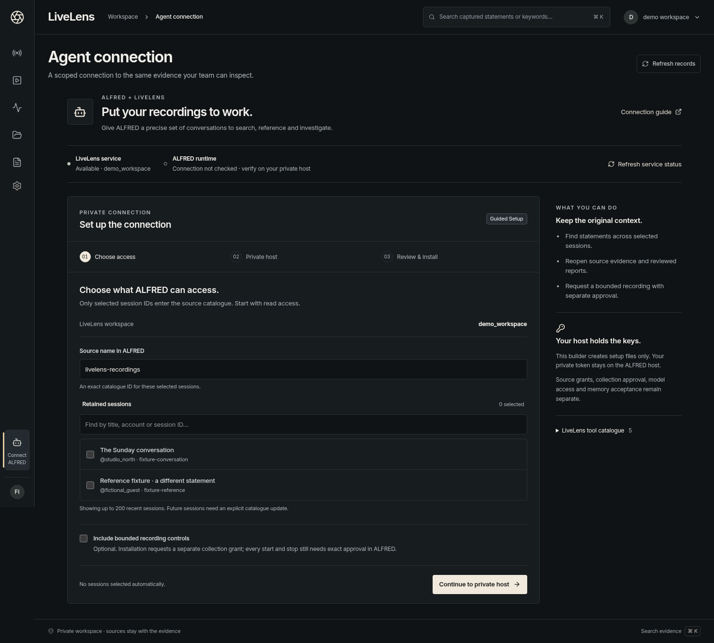

# Aperture Studio — recordings, evidence and ALFRED

LiveLens now carries the approved Aperture design through four working tasks:
move through a recording, find evidence anywhere in a retained conversation,
reopen saved moments, and prepare a private ALFRED connection.

[Full-size conversation](screenshots/operator-workflow/01-conversation-full.png) ·
[Phone conversation](screenshots/operator-workflow/04-conversation-phone.png) ·
[Session library](screenshots/operator-workflow/03-library-desktop.png)

## Move through the recording

The retained-time scrubber spans all valid segments in the selected recording.
Keyboard Home/End and five-second arrows, back/forward 15 seconds, playback speed
and the original media selector work together. Playback advances to the next
retained segment in that job and preserves speed. A separate Recording selector
changes jobs; it pauses playback rather than interleaving simultaneous recordings.

Retained time excludes gaps. Segment markers and a gaps/overlaps disclosure expose
actual collector coverage; overlapping files remain separate. Selecting evidence
uses its collector timestamp only. Missing timestamps and uncovered moments leave
the original context available with an explicit alignment message. Provider and
receipt timestamps never substitute for media alignment.

## Find the conversation, then the statement

Library title/account search runs over the workspace's retained sessions before
200-row pagination. `@account` and literal `%`/`_` characters work. The With video
filter still describes loaded capture receipts and the current page; it does not
pretend to establish complete library media coverage.

Conversation text/attribution search and kind filters run before 100-event
pagination. Next/previous navigation preserves the search; changing text or kind
returns to its beginning. Requests are debounced, previous rows disappear while
pending, and late responses cannot replace the current query. Matching is literal
substring search; ASCII case matching is portable across SQLite/PostgreSQL.

Saved moments retrieve missing originals by exact evidence ID. Quotes, original
clocks and real decoded frames therefore survive changing pages or search filters.
Reads are bounded to visible rows, cancelled on context change, and cached to avoid
polling the same original repeatedly. Unavailable evidence or media retains an
honest fallback. Selecting the same saved moment can seek again after manual playback.

## Prepare ALFRED access

1. Choose explicit session IDs from up to 200 recent sessions. Nothing is selected
   automatically. Read access is the default; recording controls are optional and
   request a separate bounded collection grant.
2. Supply the LiveLens origin and existing ALFRED scope/private host directories.
   The builder rejects credentials, paths and query strings in the API origin and
   checks the documented path/identifier contracts. Host filesystem placement is
   still verified by ALFRED itself.
3. Download the connection JSON, test-read JSON, quoted host commands or complete
   recipe. Install privately and verify actual selected-session reads on ALFRED.

[Private host inputs](screenshots/operator-workflow/08-alfred-host-desktop.png) ·
[Generated recipe](screenshots/operator-workflow/09-alfred-recipe-desktop.png) ·
[Phone setup](screenshots/operator-workflow/11-alfred-host-phone.png) ·
[Phone recipe](screenshots/operator-workflow/10-alfred-recipe-phone.png)

The browser asks for no token, writes no private inputs to browser storage/URLs,
and sends no request to the supplied origin. Generated commands match the pinned
[ALFRED integration](ALFRED_INTEGRATION.md). LiveLens service availability and private
ALFRED registration have separate status. A recipe is not an installed connection.

## Actual captures and verification

| Screen | Browser capture |
|---|---|
| Conversation | [Desktop viewport](screenshots/operator-workflow/01-conversation-desktop.png) · [full page](screenshots/operator-workflow/01-conversation-full.png) · [phone](screenshots/operator-workflow/04-conversation-phone.png) |
| Monitor | [Desktop](screenshots/operator-workflow/02-monitor-desktop.png) · [phone](screenshots/operator-workflow/06-monitor-phone.png) |
| Navigation | [Phone drawer](screenshots/operator-workflow/05-navigation-phone.png) |
| ALFRED | [Choose access](screenshots/operator-workflow/07-alfred-access-desktop.png) · [private host](screenshots/operator-workflow/08-alfred-host-desktop.png) · [recipe](screenshots/operator-workflow/09-alfred-recipe-desktop.png) |

These are actual authenticated browser captures of a synthetic studio demo. The
portrait is a generated still recorded with tone through FFmpeg into three segments,
6.023 seconds total. Captions are illustrative API fixture text, not recognised
speech. Saved thumbnails are decoded from actual retained media. ALFRED origin and
paths are fictional inputs; no private host was contacted. This media is confined
to the isolated screenshot fixture, not installed as production placeholder video.

[Validation](VALIDATION.md), [layout and screenshot hashes](operator-workflow-layout-validation.json)
and [design QA](../../design-qa.md) record the tested artifacts and limits. The standard
`npm run console:fixture` continues to use generated test media. Desktop captures
use 1487 × 1058, phone 390 × 844; long images are explicitly full-page.

The next acceptance work is real authorised LIVE capture, representative long and
overlapping speech, private ALFRED installation and customer operational testing.
The existing desktop CRM remains separate local storage. Production deployment,
payments and public signup are not established by these fixture checks.
