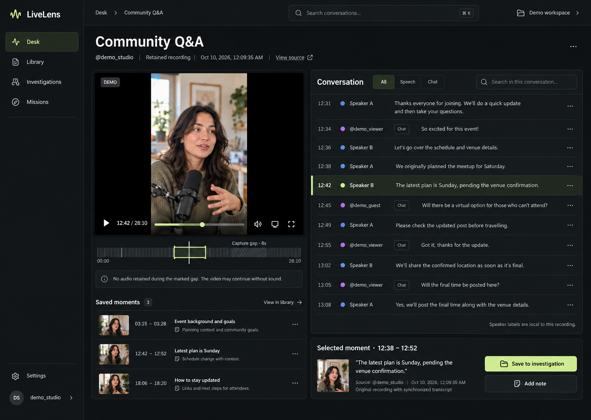
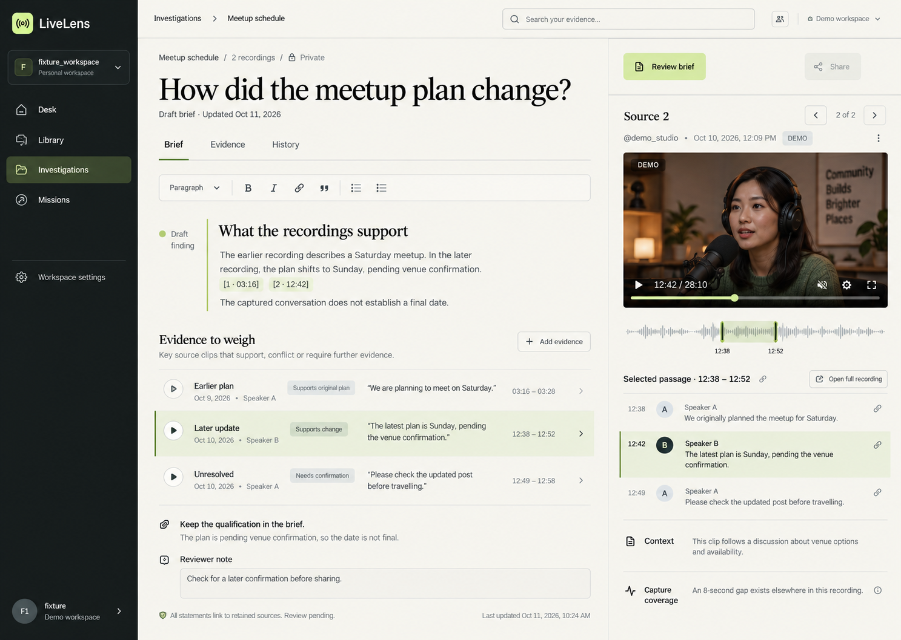
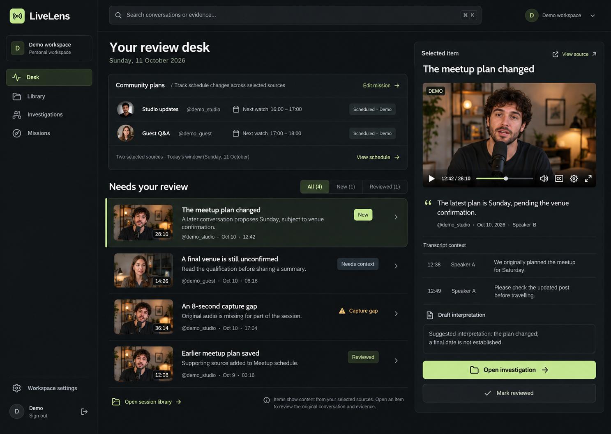
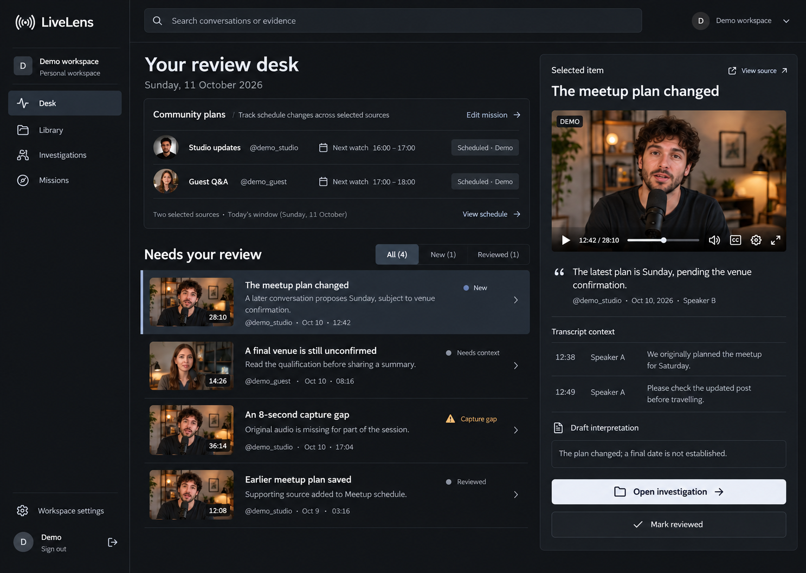

# LiveLens design concepts

Generated visual directions for owner review on 11 October 2026. These are
concept images, not screenshots of implemented UI or proof of provider access.
All depicted media, accounts, statements and schedules are fictional demo material.
Actual application screenshots remain in [SCREENSHOTS.md](SCREENSHOTS.md).

## 1. Conversation Desk

Replay and synchronized conversation, with original context beside the selected
moment and a clear action to save evidence to an investigation.

## 2. Investigation Studio

A readable draft brief with supporting and qualifying evidence, keeping the
original source clip visible during review.

## 3. Mission Inbox

A queue of conversations and evidence needing review, with compact selected-source
schedules and source context beside the selected item.

These images document the original visual exploration. The owner's selection
and refinement are recorded below; current behavior is described in
[REVIEW_DESK.md](REVIEW_DESK.md).

## Selected layout and visual revision

The owner selected the third direction's inbox/detail structure and rejected
the neon accents. The revised target uses warm charcoal, off-white actions and
subdued slate selection states. It is a design reference, not an application
screenshot. The owner subsequently requested, then deferred, Pinterest research
after the cloud network blocked access. No Pinterest pins were viewed or used
as a claimed reference for this implementation.

