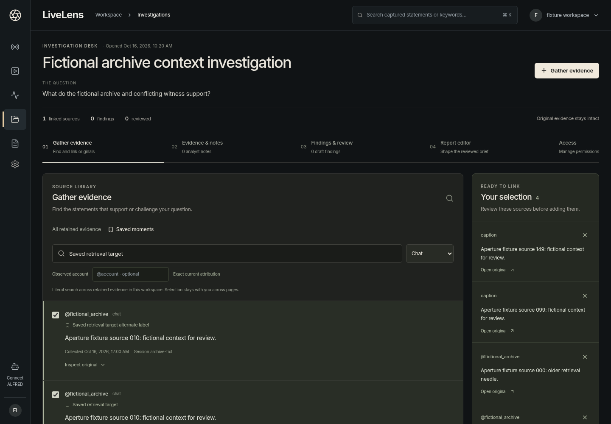

# Aperture Investigation Desk

Delivery goal, 16 October 2026: an operator can turn retained conversations into
a reviewed, source-backed brief in one coherent workspace, using the approved
Aperture Studio visual language.

## Delivery plan

1. **Gather.** Search retained statements and saved moments by literal text,
   account and kind. Apply filters before bounded pagination. Preview originals,
   keep an explicit selection across result pages, and link the selection in one
   atomic request. Show duplicates and failures truthfully.
2. **Connect.** From a conversation, find an accessible investigation or create
   one with the selected statement in the same transaction. Reopen original
   context from an investigation and return to that investigation.
3. **Review.** Give the question and sources a clear hierarchy. Show actual
   source, finding and review counts with next actions. Preserve supporting and
   conflicting evidence, notes, immutable reviews, redactions and report exports.
4. **Prove.** Exercise search beyond a page, selection across filters, duplicates,
   denied access, atomic failure, original context, reviewed export and restart.
   Inspect actual desktop, phone and keyboard browser captures.
5. **Publish.** Commit the code, delivery receipt and actual screenshots on the
   continuation branch. Keep the plan and backlog aligned with tested behavior.

## Acceptance contract

- No evidence IDs need copying to gather a case from retained conversations.
- A failed batch adds nothing. Repeating a completed batch does not duplicate
  sources. Creating with evidence cannot leave an empty case on validation failure.
- Workspace, scope, role and case access checks remain independent. Inaccessible
  cases do not consume visible search pages. UI states never grant authority.
- Source, collector and receipt clocks remain distinct. Source text and operator
  interpretations remain separate. Gathering evidence does not approve a finding.
- Query changes hide previous results immediately; late responses cannot replace
  the active query. Selections remain visible, bounded and explicit.
- The existing recorder, recording transport, private ALFRED setup, Electron CRM
  and report contracts keep working.

## Programme after this milestone

| Goal | Exit evidence |
|---|---|
| Provider pilot | One explicitly selected permitted LIVE captured, stopped and replayed with real provider failure receipts. |
| Speech quality | Representative long, noisy and overlapping recordings; measured transcription and anonymous-speaker quality. |
| Private ALFRED operation | Install on the owner's actual private host; verify scoped reads and separately approved bounded collection. |
| Operational pilot | Defined capacity, storage/recovery and queue budgets tested under representative load, then an invited deployment. |
| Commercial release | Production isolation and recovery, payments and measured support/cost limits. |

These later gates require their own evidence. This milestone does not deploy a
service, connect a private host, or claim external LIVE or speech accuracy.

## Delivery receipt

The operator workflow is implemented and verified against the real local service.
127 application tests and all 148 service tests pass, including PostgreSQL, speech
and PDF. The new browser journey verifies actual writes, lost-response recovery,
permission failures, draft conflicts, review capacity and restart. Fifteen actual
desktop/phone captures are linked below; the final aggregate receipt also covers
the existing recorder, review, access and onboarding journeys.

### Operating guide

Open **Investigations**, create a question or search the accessible case library,
then choose **Gather evidence**. Search text literally, optionally filter an exact
current account or event kind, or browse saved moments. Inspect the original clocks
before selecting sources. The visible tray keeps selections across pages, filters
and temporary source playback; **Add sources** saves one atomic batch.

From a conversation, choose **Add to investigation**. Search accessible cases or
choose **New investigation** to save the question and original statement together.
**Open investigation** continues into the case. **Return to investigation** restores
the open tab and unsaved tray/notebook/report state after inspecting a source.
An explicit navigation away or page reload ends in-memory drafts; they are not
stored in the browser. Saved work survives service restart.

Use **Evidence & notes** for observations, **Findings & review** for supported or
conflicting interpretations, and **Report editor** for the saved brief, redactions
and exports. Gathering sources never marks a finding reviewed. Dirty report edits
survive refresh; an explicit discard reloads the saved revision. Concurrent report
changes retain the server's revision-conflict check.

### Bounds and compatibility

- Intake pages show up to 50 matches; the tray holds at most 50 originals. Reviewed
  investigations hold up to 200 linked originals. The service rechecks that limit
  atomically, including concurrent additions. Duplicate bookmarks retain their
  distinct labels while selection deduplicates the original statement.
- Legacy original-evidence cases retain their 1,000-source API limit. Existing
  larger cases remain bounded in the reviewed interface and are explicitly marked;
  they are not represented as complete reviewed reports.
- Search and case pages use offsets over current retained data, not immutable
  snapshots. Appends/deletions can shift pages; selected originals stay explicit.
- Linking validates retained IDs/workspace and preserves originals. Export verifies
  referenced journals; adding a source is not a new integrity certification.
- ALFRED's existing HTTP/CLI contracts remain compatible. No private ALFRED host,
  external LIVE, public deployment or commercial capacity is validated here.

## Actual interface

| Task | Actual browser capture |
|---|---|
| Create around a statement | [Desktop](screenshots/investigation-desk/01-desktop-create-from-conversation.png) |
| Gather and review selection | [Full desk](screenshots/investigation-desk/02-desktop-gather-across-pages.png) · [phone viewport](screenshots/investigation-desk/06a-phone-gather-viewport.png) |
| Recover a denied write | [Selection preserved](screenshots/investigation-desk/03-desktop-permission-selection-retained.png) |
| Review a finding | [Desktop](screenshots/investigation-desk/04-desktop-reviewed-finding.png) · [phone](screenshots/investigation-desk/07-phone-reviewed-finding.png) |
| Preserve a conflicting draft | [Actual revision conflict](screenshots/investigation-desk/05a-desktop-draft-conflict-preserved.png) |
| Respect review capacity | [200-source review](screenshots/investigation-desk/05b-desktop-full-review-capacity.png) |
| Inspect source clocks | [Phone provenance](screenshots/investigation-desk/06b-phone-original-provenance.png) |
| Save a brief | [Desktop](screenshots/investigation-desk/05-desktop-reviewed-brief.png) · [phone](screenshots/investigation-desk/08-phone-reviewed-brief.png) |
| Reopen after restart | [Same retained brief](screenshots/investigation-desk/10-phone-restarted-brief.png) |

Every capture uses fictional fixture evidence in the real app. No external LIVE,
private ALFRED installation or production deployment is implied. Modal and named
viewport images show the actual viewport; other images are full-page captures.

[Executed browser checks](investigation-desk-browser-validation.json) ·
[Database/service checks](investigation-desk-service-validation.json) ·
[Build and application tests](investigation-desk-build-validation.json).
