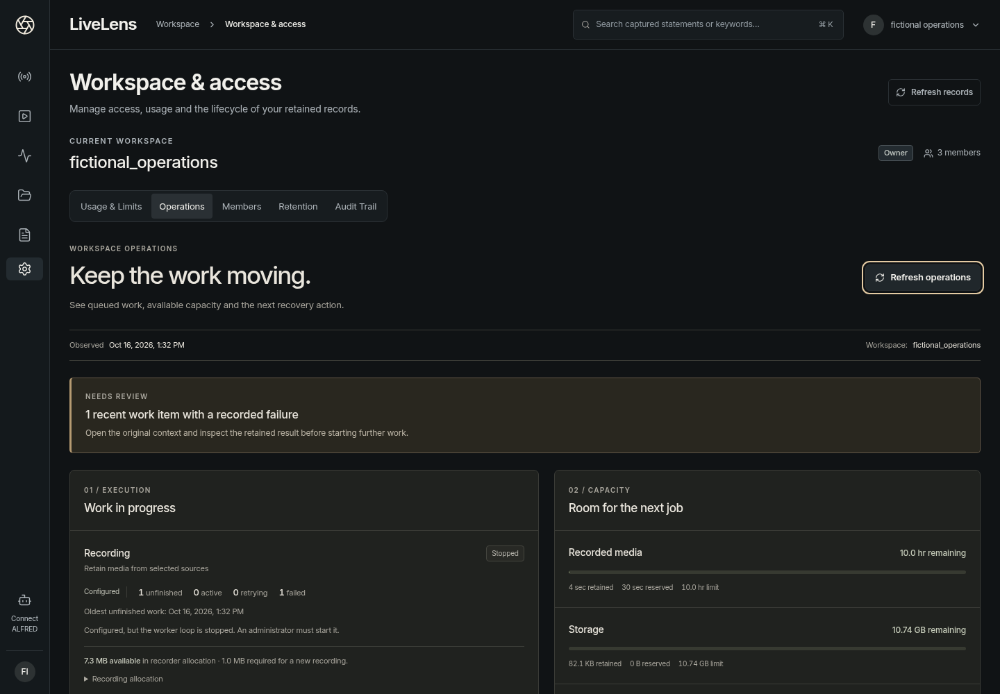

# Aperture Operations & Recovery

O01 makes the existing capture and investigation application easier to operate
and recover. It implements stage 2 of the [standing programme](MASTER_PLAN.md).
The capture-first monitor remains the main entry point; this workflow lives in
**Workspace & access → Operations** and **Retention**.

## Read the state before starting more work

Operations shows an observation timestamp, work needing attention, actual scoped
worker state and workspace capacity. Refresh explicitly to obtain a new snapshot.
Failed refreshes identify the last available snapshot; a failed usage read shows
capacity unavailable. Operations remains reachable when workspace usage fails.

| State | Meaning |
|---|---|
| Not configured | This process has no instance of the optional worker. Retained outcomes may still exist. |
| Stopped | A worker instance exists but its loop is stopped. |
| Idle | The configured loop is available, with no active job in this workspace at observation time. |
| Running | The loop exists and scoped persisted work is in an active state. |
| Error | The worker has a recorded process-loop failure. |
| Restricted | The caller lacks that worker's read authority; configuration and counts are withheld. |

These observations do not probe a provider or certify capture/transcription
quality. Unfinished counts include active and retrying work. Counts cover the
scoped queue before the attention list is bounded to the latest 20 retained
failures. Open conversation returns to the accessible original session. An
archive restore outcome takes precedence over its older upload outcome.

## Understand the two capacity constraints

Workspace capacity subtracts retained usage **and reservations**. Storage includes
known local media and logical encrypted archive usage; an unfinished retention
cleanup task keeps its known bytes reserved. The storage disclosure separates
local, archived, archive-reserved and awaiting-cleanup bytes. This is neither
filesystem free space nor billing, and untracked files are not measured.

Recorder allocation is a separate conservative guard. Each unfinished recording
reserves the configured per-job maximum. The Recording row exposes available and
required bytes, plus concurrent/pending bounds. Both workspace limits and recorder
allocation must admit the next recording. Do not add those separate budgets and
present them as one quota. See [runtime configuration](RUNTIME_CONFIGURATION.md).

## Recover partial retention cleanup

1. Configure retention, preview eligible sessions and explicitly select the
   originals to delete. Apply requires the current preview hash and a reason.
   Existing evidence-reference and active-work protection still applies.
2. Record deletion and a per-recording cleanup task commit together before media
   removal. A partial result clearly separates deleted records from unfinished
   physical cleanup. It does not imply that the original records can be restored.
3. In Retention, inspect Media cleanup. Tasks persist across restart and show the
   actual pending/failed/completed state, known bytes, attempts and safe error code.
4. Correct the filesystem problem on the configured host. Select the exact task,
   give a reason and retry. A failed retry preserves its reason and reservation;
   a completed receipt releases the reservation. History and audit remain.

Retries require current owner/admin membership **and** `workspace:admin`. They
operate only on the recorded directory identity beneath the original configured
root, refuse symlink/replacement/reused-job conflicts and are idempotent once
completed. A new recording cannot reuse an ID with unfinished cleanup.

`cleanup_target_changed` or missing original identity requires administrator
investigation: restore the correct original mount/directory before retrying where
possible. Do not bypass identity checks, rewrite task rows or delete an arbitrary
path to manufacture success. This release has no force-resolve operation for a
lost original volume. Pending work therefore remains visible and keeps its
reservation until safe resolution is possible. No cleanup timer is installed.

## Back up and prove recovery

Stop recording/speech jobs and finish pending cleanup before creating an encrypted
SQLite/local-media backup. Unfinished cleanup is tied to original filesystem
identities, so backup refuses it both before and after copying the database.
Retain the backup key separately; restore accepts a new directory and starts no
service. Follow the [backup runbook](../../deployment/livelens/README.md).

The [pilot drill](PILOT_DRILL.md) uses its own on-disk data and real generated-media
captures. After backup, it deletes its own original database/media/inputs, restores
into a new directory and starts a fresh authenticated API without capture sources.
It compares original clocks/events, notes, bookmarks, findings/reviews, report
editor/redactions, access grants, audit and exports, then downloads and decodes
every restored segment after comparing its original hash.

The [final receipt](pilot-drill-validation.json) records 600 mixed requests with
zero unexpected errors and six requests in flight, two overlapping recordings,
2,240 recovered originals and 16 exact, decodable media segments. This short paced
fixture does not establish saturation capacity, a crash recovery-point promise,
PostgreSQL/object-store recovery or production readiness.

## Verification and actual screens

[Desktop](screenshots/operations/01-desktop-operations.png) ·
[Partial cleanup](screenshots/operations/03-desktop-retention-cleanup-failed.png) ·
[Phone](screenshots/operations/05-phone-pending-cleanup.png) ·
[Completed cleanup](screenshots/operations/07-phone-cleanup-complete.png) ·
[Unavailable capacity](screenshots/operations/10-phone-capacity-unavailable.png).

See [validation and source hashes](VALIDATION.md), the [screenshot gallery](SCREENSHOTS.md)
and the [API contract](../../services/intelligence/README.md). Browser acceptance
uses actual authenticated HTTP, actual FFmpeg media and a real filesystem
permission refusal. Fictional workspaces and generated media are labelled.

The wider programme remains active. Real LIVE, representative speech/context
quality, private ALFRED installation, production migration/deployment and
commercial acceptance retain their own exit criteria in the master plan.
