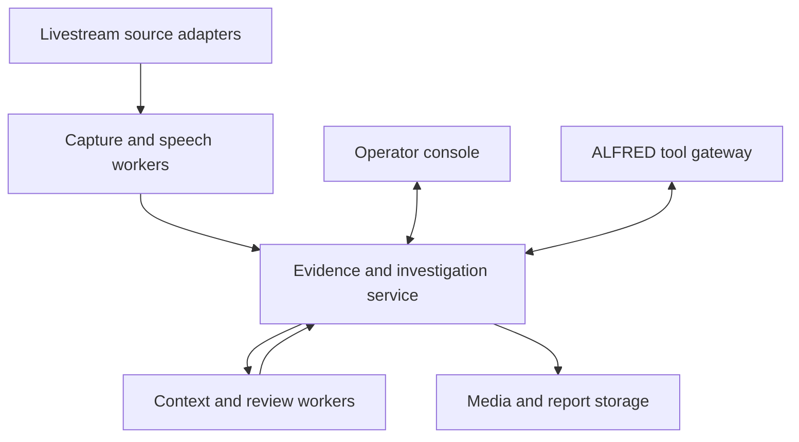

# LiveLens: live conversation intelligence

The [standing product goal and current delivery programme](MASTER_PLAN.md) supersede historical next-step wording in this document.
Current implementation and measured limits are recorded in [FULL_APPLICATION.md](FULL_APPLICATION.md),
[VALIDATION.md](VALIDATION.md) and the backlog. This document retains the full target architecture;
the build-order sections are a programme rather than an assertion of production readiness.

Product direction, 10 October 2026. The goal is an operational intelligence
platform that can serve the owner, paying users, creator teams, investigators and
ALFRED. TikTok is the first source adapter. The community manager is an existing
collection and interface asset within the wider product.

The latest requirement is a complete application and a substantial design
overhaul, with eventual server operation for hundreds of users as a measured
target. Read [APP_BLUEPRINT.md](APP_BLUEPRINT.md) for the full navigation/screen
map, design direction, earlier-plan consolidation and commercial growth gates.
The current entry point is a capture-first LIVE monitor; see
[LIVE_MONITOR.md](LIVE_MONITOR.md). Selected accounts, bounded checking/watching,
Record/Stop, retained video with chat and recent recordings make collection the
first task. Review, investigations and reports follow the captured conversation.
U00 introduces a real operator app over the existing API alongside C01; U01
later completes media replay and worker operations. Backend-only progress does
not satisfy the full app brief.

## The product question

Owner direction, 11 October 2026: a working monitor and recorder must be
recognisable on opening the app. The review-inbox home is secondary. Earlier
test and screenshot receipts prove particular functions, not final design
acceptance. The restrained charcoal/slate palette remains useful; the page
hierarchy now prioritises accounts, capture controls and a large media workspace.

With the existing application and all eight source repositories available, what
should we build that none of them supplies together?

**A continuous conversation-to-evidence-to-action system.** Collect available
media and events, reconstruct conversations, investigate what matters, preserve
supporting and conflicting evidence, and make the same capabilities available to
human operators and authorised agent tools.

Protecting a person or community is one mission. Others include public debate
research, creator intelligence, documenting disputes, topic monitoring and
cross-session analysis. Reports describe observed activity and source-supported
claims. They do not assign a universal judgement about a person.

## Platform areas

| Area | Product behaviour | Current status |
|---|---|---|
| Operations | Active sources, worker health, capture gaps, backlog, storage and spend | Desktop monitoring and real operator console implemented; spend is manual entitlement |
| Collection | Selected accounts, LIVE status, scheduled collection and concurrent capture | Concurrent bounded recorder and explicit selected-source scheduler implemented; external LIVE unvalidated |
| Conversation | Replay synchronised media, chat, captions, independent speech and speaker turns | Media/chat/caption replay and optional independent speech implemented; diarisation unmeasured |
| Observed accounts | Search statements and comments associated with captured accounts across sessions | Source-linked account activity UI and literal search implemented |
| Context graph | Claims, topics, appearances and source-supported links with relationship status | Source-backed graph with observed/reviewed/inferred status implemented; identities remain assertions |
| Investigations | Questions, evidence, counterevidence, notes, reviewer decisions and timelines | Notes, support/counterevidence, findings and immutable review workspace implemented |
| Reporting | Evidence exports, reviewed findings, redaction and shareable briefs | Reviewed redacted JSON/Markdown/HTML/PDF implemented; external model quality unmeasured |
| Protection missions | Named protected account, selected sources, detection rules and reviewed alerts | Explicit retained-session contextual rules and in-app review implemented |
| Agent gateway | Scoped queries and explicitly approved bounded collection from ALFRED | Actual optional authenticated ALFRED HTTP/CLI tools tested in draft PR #20; private installation is explicit, branch unmerged/undeployed |
| Commercial operation | Workspaces, access controls, quotas, subscription metering and retention | Roles/case ACL/quotas/audit/retention and optional PG/archive implemented; payment/customer rollout partial |

## Shared architecture

The interfaces share one source-linked data model. Media remains separate from
the event journal. Speech engines emit anonymous tracks; an account mapping is
its own assertion. Analysis results retain evidence IDs and their review status.
Captured text is data supplied to analysis, never an instruction that can grant
an agent new authority.

Production target: React/TypeScript console; long-running Node/Python workers;
PostgreSQL for indexed entities; object storage for segmented media; durable
queues and bounded schedulers. The new SQLite service proves the event/case/API
contract before that migration. It is not a capacity benchmark for the target.

## Connection with ALFRED

ALFRED is the personal operational interface and coordinator. LiveLens is a
specialist source and conversation engine. Keep those responsibilities distinct
while giving ALFRED the same scoped tools used by the operator console.

Examples of the intended interaction:

- "Show what was actually said about this subject in our captured sessions."
- "Prepare a brief with the quotations, context and unresolved identities."
- "Compare this account's observed statements across these sessions."
- "Create a collection job for these sources with a two-hour cap."
- "Tell me when a reviewed rule is triggered in this protection mission."

Actual optional ALFRED source reads and exact approved bounded recording controls
are implemented in [draft PR #20](https://github.com/EmotiveImpact/Alfred/pull/20),
commit `5b37ba41353cfcd0cae4243482520e25175e21d9`. They use authenticated Desk
HTTP tools or the owner operator CLI, after explicit private installation and
grants. The local ICS/VCF registry remains unchanged. The conversation model does
not automatically invoke those tools; semantic quality, automatic memory import
and production connection are not claimed. Read [ALFRED_INTEGRATION.md](ALFRED_INTEGRATION.md)
for the exact operating guide and configured-fixture receipts.

## Build sequence and release gates

1. **Persistent intelligence foundation:** pinned source library, event contract,
   durable evidence, account search, case exports and scoped clients. Implemented
   in this draft and tested with synthetic fixtures.
2. **A complete recorded session:** one accessible media source plus chat; durable
   recording job, source/receipt clocks, segment hashes and crash recovery. Start
   with the recorder patterns from the imported Node and Python projects.
3. **Independent conversation processing:** speech worker, anonymous diarisation,
   uncertainty and synchronised replay. Benchmark on reference recordings before
   making username attribution claims.
4. **Server operations and two concurrent sessions:** LIVE-status scheduler,
   idempotent start/stop, leases, bounded retries, recording gaps and quotas.
5. **Investigation console:** session library, account activity, evidence viewer,
   speaker correction, case notes and a report editor over the same API.
6. **Context intelligence:** source-linked claims, topics, possible incident flags,
   counterevidence and human review. Search results and AI findings remain distinct.
7. **ALFRED operation:** register the read interface, then add separate collection
   controls and explicit memory-source ingestion through ALFRED's policy layer.
8. **Paid pilot:** case permissions, metering, retention/deletion, storage recovery,
   notifications, billing and measured service limits before customer deployment.

The next useful vertical slice is one replayable recorded conversation that
survives a worker restart and produces a report whose evidence can be reopened.
That gives the larger console and ALFRED reliable material to work with.

Begin the operator app U00 alongside C01 rather than delaying every interface
improvement until the entire recording/speech stack exists. Keep its available
features grounded in real service data; complete C02/C03 for recording, then
expand the same app through A01/C04/U01 and the later intelligence milestones.
