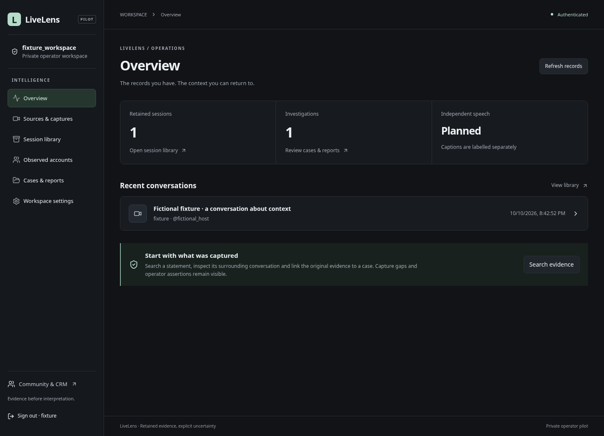

# LiveLens screenshots

These are actual screenshots of the running private pilot interface, captured
at a desktop viewport of 1440 × 1040. All displayed content is synthetic fixture
data. The colour bars and tone are the test recording used to verify replay.

## Dashboard

## Recording replay and evidence

The selected fixture evidence predates this retained recording. The application
shows that no retained segment covers its timestamp instead of claiming an
aligned replay.

## Cases and reports

