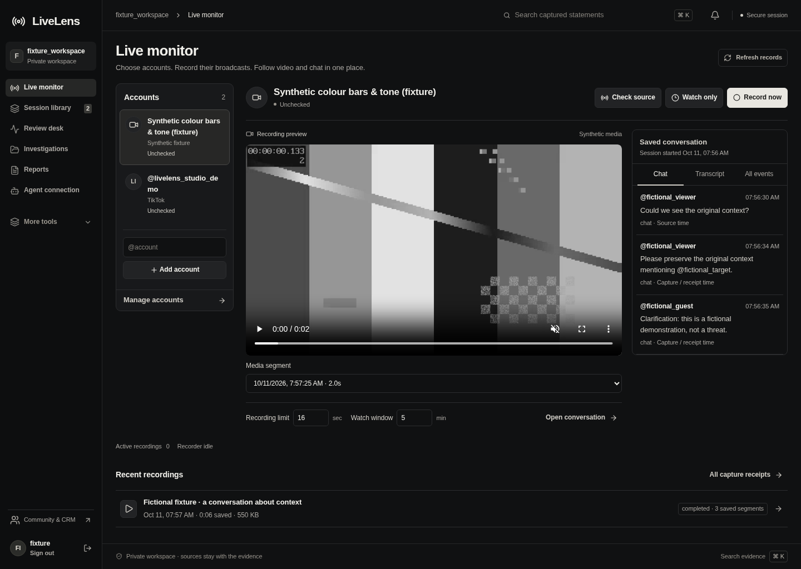
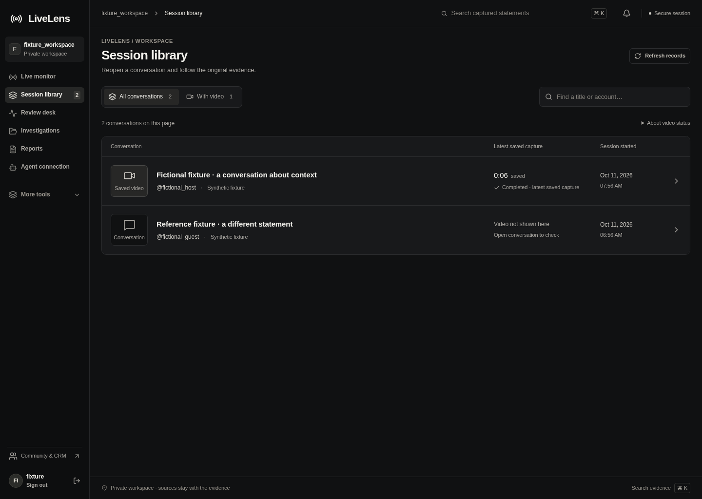

# LiveLens recording workspace refinement

11 October 2026. This implements the next design pass requested after the
[eight-step audit](PRODUCT_AUDIT.md). The direction is a focused dark recording
workspace: select an account, retain a broadcast, find a moment, then investigate
its context. Shared charcoal surfaces, warm text and quiet separators carry
through the actual application.

## Implemented

- **Six everyday destinations.** Live monitor, Session library, Review desk,
  Investigations, Reports and Agent connection remain visible. More tools reveals
  observed accounts, graph, missions, sources, alerts, access and settings. Direct
  links still work and open the relevant group. Phone navigation retains its focus
  trap, Escape behavior and destination focus.
- **A calmer monitor.** Source selection has concise identity rows; video and chat
  use a lighter shared workspace. Saved captures are compact selectable rows.
  Empty states distinguish a pending capture, absent video, read-only access and
  unavailable replay. Explicit collection limits and stop controls remain.
- **A useful recording library.** Rows show the account, session date and actual
  duration/state of the latest saved capture found in the loaded receipts. With
  video filters that current page. Missing receipts remain unknown, rather than
  implying that a conversation has no media. Errors and access changes remain
  visible; no thumbnail or duration is invented.
- **Playback beside the timeline.** At desktop width, the player and searchable
  timeline begin together, measured at 258px from the top in the captured fixture.
  On phones they stack in that order. Selecting evidence retains its exact source
  context below, with a View selected context action on desktop. Hash, archive and
  independent transcription controls move into Recording details & tools.
- **Review starts with the inbox.** Collection schedule is compact when idle and
  opens when a new active window appears. Its loaded status remains visible in
  the summary. Smaller inbox icons and quieter selected rows give the original
  evidence more room. Existing schedule links and permission gates are retained.

## Actual application captures

These screenshots come from the authenticated running application using final
renderer `index-DvisZsW-.js` and stylesheet `index-BAyBVht6.css`. All identities and
conversations are fictional fixtures. The main gallery uses a real six-second FFmpeg
recording of a generated monochrome test pattern, served through the authenticated
media routes. The test pattern is source footage, not a change to recording colour
or processing. No public account was polled or recorded for these captures.

| Capture | State |
|---|---|
| [Video filter](screenshots/studio-refinement/03-library-with-video.png) | One current-page conversation has a loaded saved capture. |
| [Recording tools](screenshots/studio-refinement/05-recording-tools.png) | Explicitly opened details, actual segment hash, archive and transcription controls. |
| [Review desk](screenshots/studio-refinement/06-review-desktop.png) | Idle collection disclosure, source-linked selected finding and original context. |
| [ALFRED](screenshots/studio-refinement/07-alfred-desktop.png) | Accessible from primary navigation; private connection still requires setup in ALFRED. |
| [Phone library](screenshots/studio-refinement/08-library-phone.png) | Real saved-video metadata in a responsive row layout. |
| [Phone conversation](screenshots/studio-refinement/09-conversation-phone.png) | Video, collapsed tools, timeline and context in reading order. |
| [Phone monitor](screenshots/studio-refinement/10-monitor-phone.png) | Account selection, explicit capture controls, video and saved conversation. |
| [Phone navigation](screenshots/studio-refinement/11-navigation-phone.png) | Six primary destinations and the More tools disclosure. |
| [Selected context](screenshots/studio-refinement/12-selected-context-desktop.png) | Separate browser regression fixture: original clocks, evidence linked to a case and surrounding conversation, with generated colour test footage. |

## Data and interaction boundaries

The library reads at most 200 recent recording receipts in one request per refresh.
There is no per-row media request. A missing receipt is not proof that historical
video does not exist. Duration sums the deduplicated retained segments of one
capture and does not establish uninterrupted coverage. Interrupted captures remain
visible. The About video status disclosure explains this; original conversations
remain openable when recording receipts fail or are outside the operator's scope.

Recording replay remains bound to its selected job. Returning to the monitor uses
that recording's resolvable source. Saved replay exposes no source collection
actions, and independent jobs retain their labelled stops. Source, collector and
receipt clocks remain separate. A drawer or disclosure never grants permissions.

## Verification and design review

The final build passes. All 95 application tests pass across 12 files, including
four new recording-library cases covering latest saved capture selection,
interrupted media, duplicate segments and duration formatting. Actual screenshots
were inspected at 1440px desktop and 390px phone width, with no horizontal overflow
or uncaught page errors. [Geometry receipt](studio-refinement-layout-validation.json).
All five final browser journeys pass with zero uncaught page errors, including
keyboard disclosures, receipt-backed video metadata, actual playback, permissions
and restart. Results are recorded in [VALIDATION.md](VALIDATION.md).

Shiro fix review: keep the shared palette, explicit capture controls and source
provenance. The navigation and library now support the primary recording task,
while technical maintenance is secondary. Ready for owner review as a working
design iteration. Broader user testing, full accessibility evaluation, external
LIVE/provider acceptance and a guided private ALFRED handoff remain separate work;
this pass does not establish production or final visual acceptance.

Implementation: `LiveMonitor.tsx` / `live-monitor.css`, new `RecordingLibrary.tsx`
with its model and stylesheet, `LiveLensConsole.tsx` with shared shell and new
conversation stylesheet, and `ReviewDesk.tsx` / `review-desk.css`. Existing browser
journeys use a shared visible-navigation helper and add regressions for the new
disclosures and library behavior.
