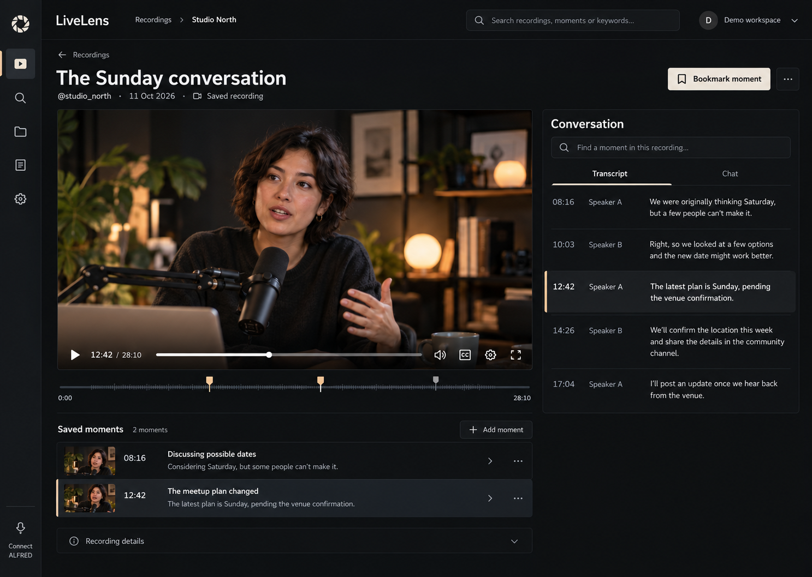
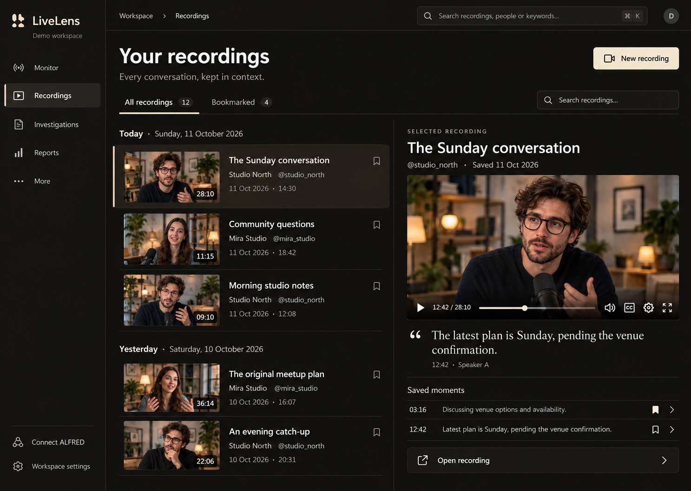
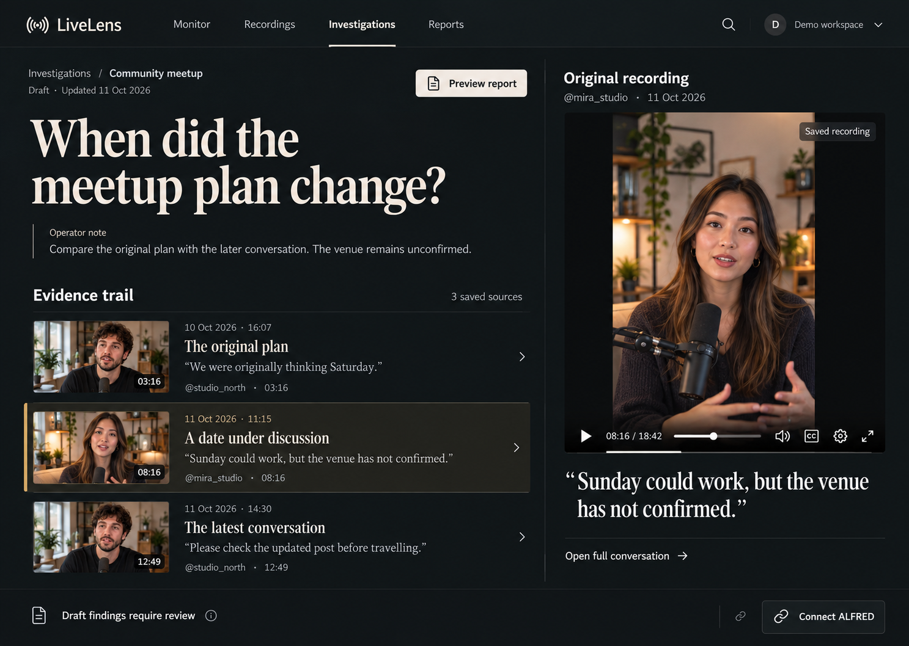

# LiveLens — three visual directions

Generated on 11 October 2026 following the request for a stronger visual design.
These are **proposed designs**, not screenshots of the implemented application.
People, recordings and conversation content are illustrative. No direction has
been selected for implementation yet.

The numbers below match the order the images appeared in the chat. Each link
opens the original full-resolution PNG; no images have been resized or edited.

## 1 — Aperture Studio

A recording-led workspace with a large player, a narrow tool rail, a searchable
conversation and saved moments.

[Open full-size image](01-aperture-studio.png)

## 2 — Obsidian Desk

A warm, dark recording library with visual source rows and a selected-recording
preview alongside the list.

[Open full-size image](02-obsidian-desk.png)

## 3 — Field Notes

An editorial investigation workspace with an evidence trail, distinctive
typography and the original portrait recording beside the source quotations.

[Open full-size image](03-field-notes.png)

## Implementation status

These images establish possible visual targets only. Illustrative controls,
metadata, thumbnails and layouts are not verification of delivered behavior.
Any selected direction must preserve existing source context, permissions and
recording semantics when implemented. See the separate
[actual application gallery](../../SCREENSHOTS.md) for the current software.
